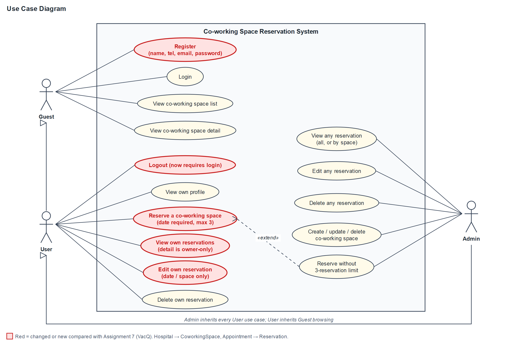
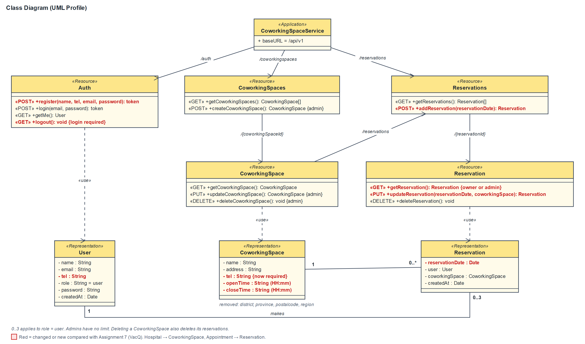
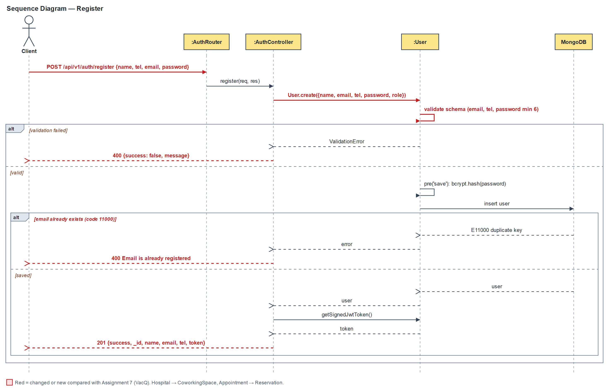
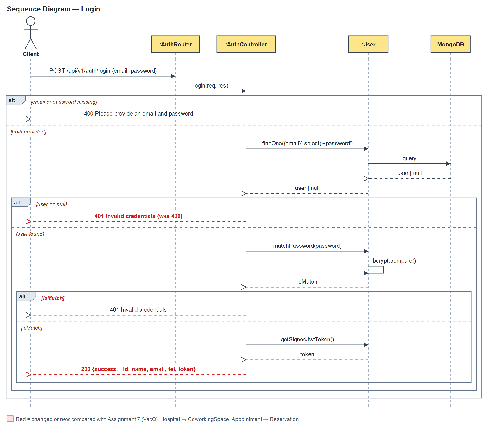
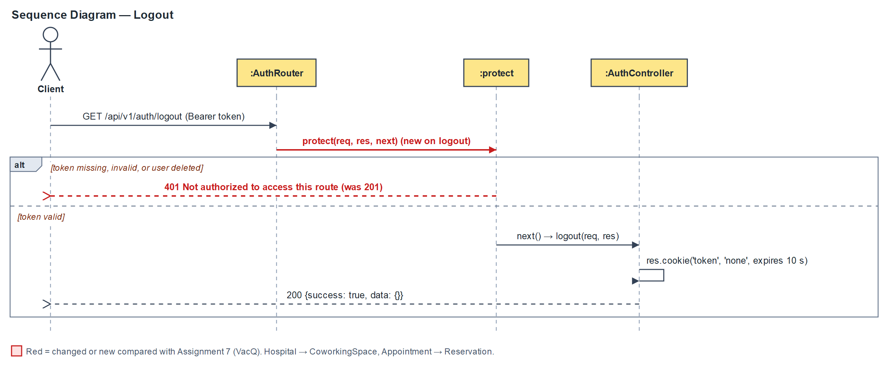
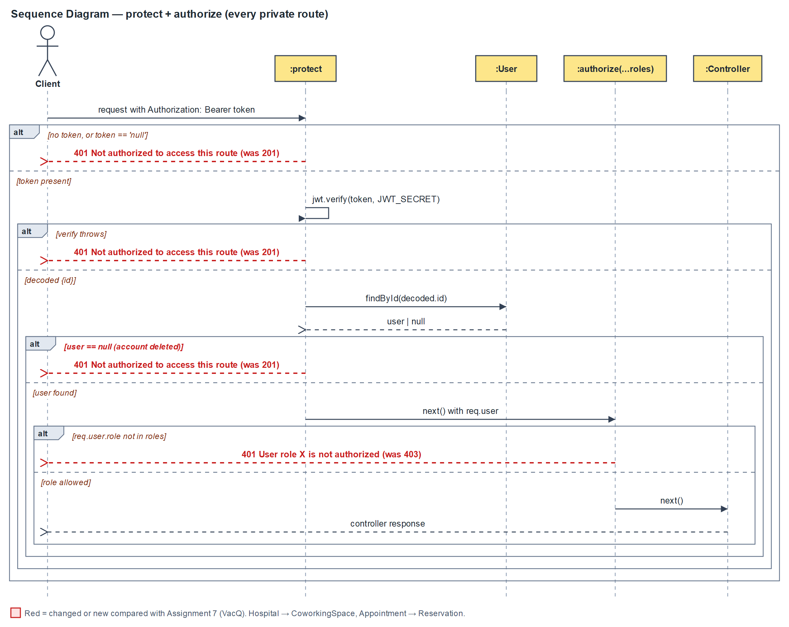
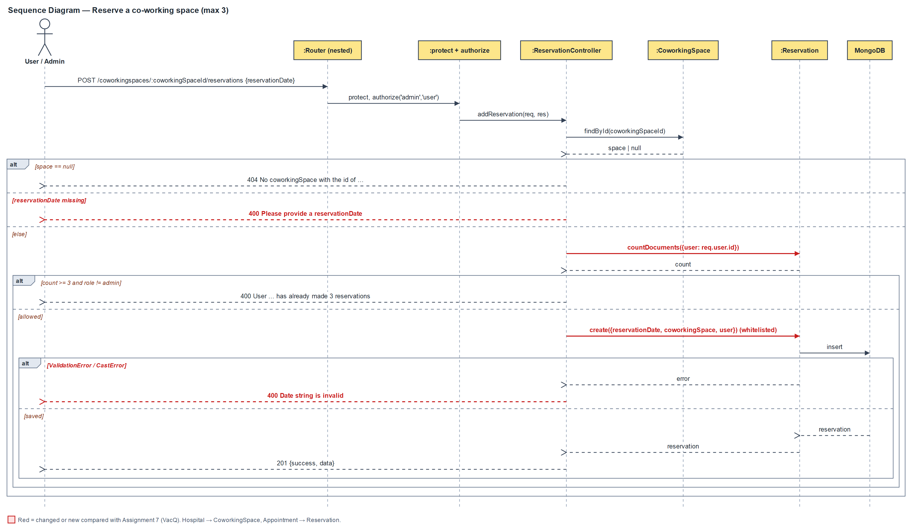
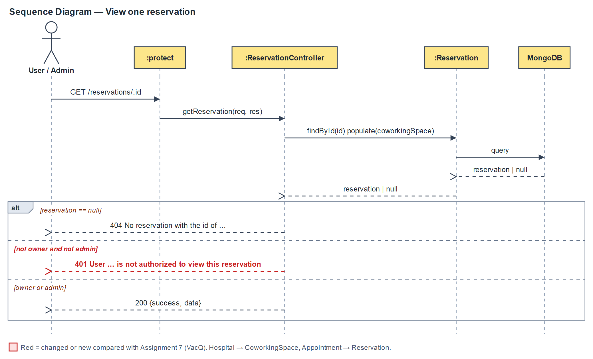
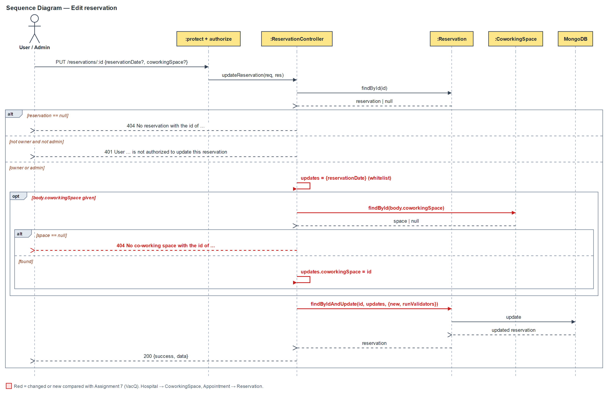

# UML Diagrams: Co-working Space Reservation API

**Red** marks what changed from Assignment 7 (VacQ). Hospital → CoworkingSpace and Appointment → Reservation are renames, so they are not marked.
Each diagram is available as SVG (sharp at any zoom) and as a 2× PNG for slides. Link the SVG or PNG from a slide if the picture is too small to read.

To regenerate after editing labels: `python docs/uml/gen_uml.py docs/uml` (strings starting with `!` are drawn in red).

## Use Case Diagram

[SVG](uml/01-use-case.svg) · [PNG](uml/01-use-case.png)

## Class Diagram (UML Profile)

«Application» → «Resource» (labelled with the URI path) → «Representation» (the model data the resource returns).

[SVG](uml/02-class-diagram-uml-profile.svg) · [PNG](uml/02-class-diagram-uml-profile.png)

## Sequence Diagrams

| # | Flow | Changed from VacQ? | Files |
|---|---|---|---|
| 03 | Register | Yes: tel, duplicate-email message, error message | [SVG](uml/03-seq-register.svg) · [PNG](uml/03-seq-register.png) |
| 04 | Login | Yes: 401 for unknown email, tel in response | [SVG](uml/04-seq-login.svg) · [PNG](uml/04-seq-login.png) |
| 05 | Logout | Yes: now protected | [SVG](uml/05-seq-logout.svg) · [PNG](uml/05-seq-logout.png) |
| 06 | protect + authorize | Yes: 401 status codes, deleted-user check | [SVG](uml/06-seq-protect-authorize.svg) · [PNG](uml/06-seq-protect-authorize.png) |
| 07 | View space list | Minor: error message | [SVG](uml/07-seq-get-spaces.svg) · [PNG](uml/07-seq-get-spaces.png) |
| 08 | View space detail | Minor: 404 instead of 400 | [SVG](uml/08-seq-get-space.svg) · [PNG](uml/08-seq-get-space.png) |
| 09 | Reserve (max 3) | **Yes**: date check, countDocuments, whitelist, invalid-date 400 | [SVG](uml/09-seq-add-reservation.svg) · [PNG](uml/09-seq-add-reservation.png) |
| 10 | View reservations | No | [SVG](uml/10-seq-get-reservations.svg) · [PNG](uml/10-seq-get-reservations.png) |
| 11 | View one reservation | **Yes**: new owner-or-admin check | [SVG](uml/11-seq-get-reservation.svg) · [PNG](uml/11-seq-get-reservation.png) |
| 12 | Edit reservation | **Yes**: field whitelist, new-space check | [SVG](uml/12-seq-update-reservation.svg) · [PNG](uml/12-seq-update-reservation.png) |
| 13 | Delete reservation | No | [SVG](uml/13-seq-delete-reservation.svg) · [PNG](uml/13-seq-delete-reservation.png) |
| 14 | Admin deletes space (cascade) | No | [SVG](uml/14-seq-delete-space.svg) · [PNG](uml/14-seq-delete-space.png) |

